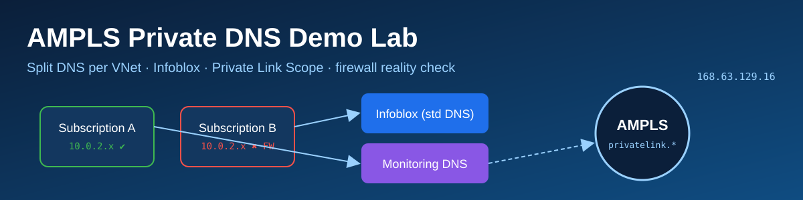
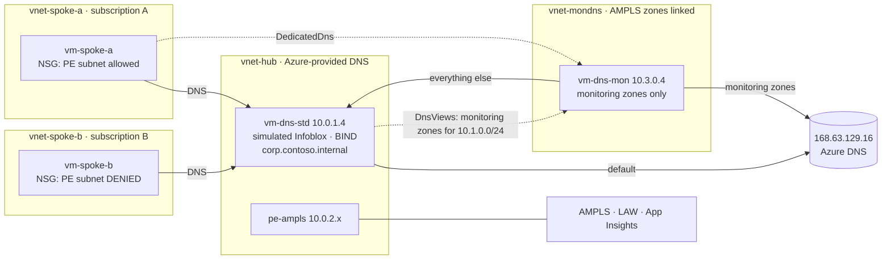
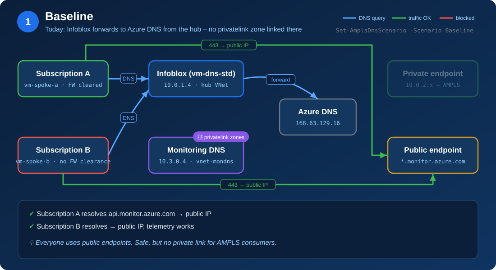
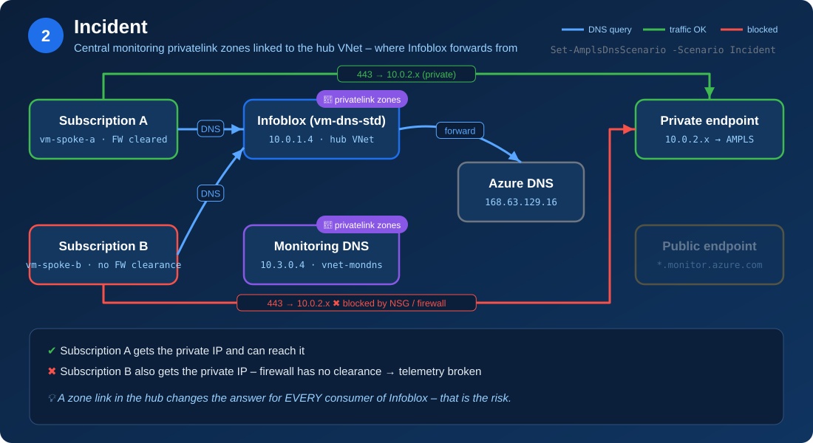
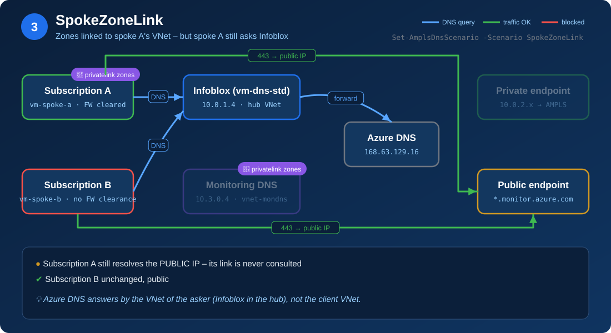
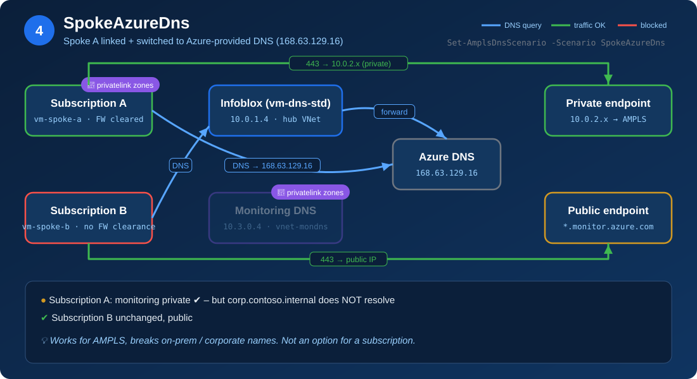
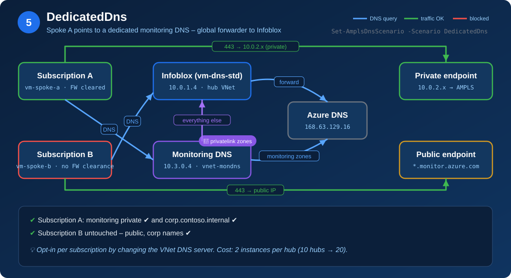
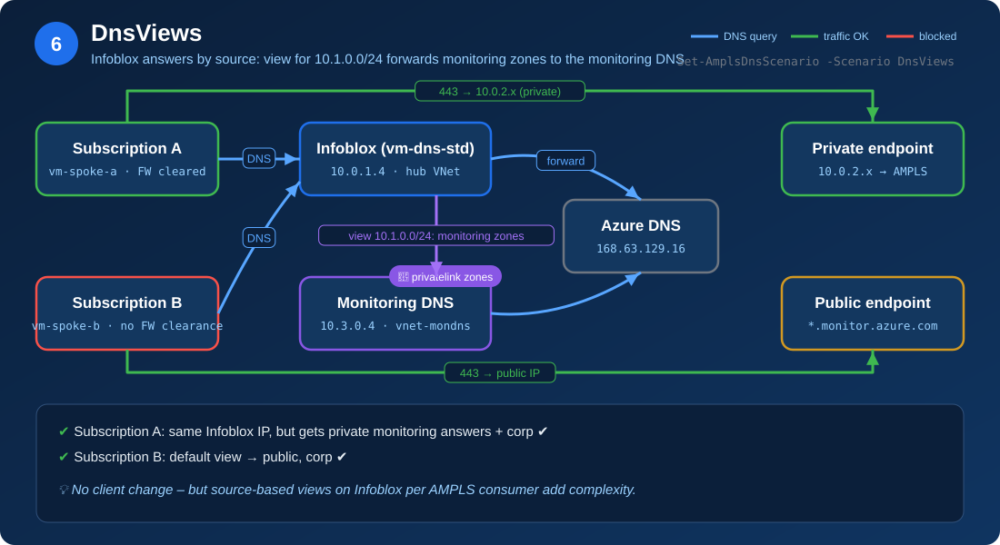

# AmplsDnsDemo

Azure demo lab for the **Azure Monitor Private Link Scope (AMPLS) private DNS** problem: how to give *selected* subscriptions (VNets) private resolution for monitoring endpoints without breaking everybody else that resolves through the central DNS (Infoblox).

One deployment, six switchable scenarios, one test command that shows *what each subscription resolves and whether it can actually connect*.

## What the lab demonstrates

| Topic from the discussion | How the lab shows it |
| --- | --- |
| Incident: monitoring private DNS zone linked centrally → private IPs for **every** subscription, firewall not cleared | `Incident` – spoke B resolves `10.0.2.x` and TCP 443 is **Blocked** |
| Split DNS is not possible inside one VNet – separation must be per VNet | VNet DNS servers are switched per spoke; one VNet = one resolver set |
| Zones created/linked *inside* the subscription have no effect while the VNet points to Infoblox | `SpokeZoneLink` – spoke A still resolves public |
| Works only via the Azure platform resolver (168.63.129.16) – but then corporate DNS is lost | `SpokeAzureDns` – spoke A private, `app01.corp.contoso.internal` fails |
| Dedicated DNS holding only monitoring zones + conditional forwarder for everything else | `DedicatedDns` – spoke A private + corp OK, spoke B untouched |
| Alternative: Infoblox answers differently by source VNet (DNS views) | `DnsViews` – same result as `DedicatedDns`, without changing VNet DNS |
| Two records (control + data plane), public name via CNAME | Test shows `api.monitor.azure.com`, `global.handler.control…`, `<ws>.ods/oms…`, blob |
| Scaling: hubs × 2 × number of AMPLS (≈3,000 resources each) | `Get-AmplsDnsScaleEstimate.ps1` → 10 hubs = **20** extra instances per AMPLS |

## Architecture



- **vm-dns-std** simulates Infoblox: forwards to Azure DNS from the hub and hosts a corporate zone.
- **vm-dns-mon** is the dedicated instance: forwards only the monitoring parent zones (`monitor.azure.com`, `oms/ods.opinsights.azure.com`, `agentsvc.azure-automation.net`, `blob.core.windows.net`) to Azure DNS in a VNet where the AMPLS `privatelink.*` zones are linked; everything else goes back to vm-dns-std.
- **NSG on spoke B** plays the subscription firewall without clearance for the private endpoint IPs.
- AMPLS access modes are **Open**, so public endpoints keep working – only DNS decides the path.

## Scenarios

| # | Scenario | Hub link | Spoke A link | Spoke A DNS | Std DNS mode | Expected |
| --- | --- | --- | --- | --- | --- | --- |
| 1 | `Baseline` | – | – | Infoblox | forward | A public · B public |
| 2 | `Incident` | ✔ | – | Infoblox | forward | A private ✔ · B private **blocked** |
| 3 | `SpokeZoneLink` | – | ✔ | Infoblox | forward | A **still public** · B public |
| 4 | `SpokeAzureDns` | – | ✔ | Azure DNS | forward | A private, corp **fails** · B public |
| 5 | `DedicatedDns` | – | – | Monitoring DNS | forward | A private + corp · B public + corp |
| 6 | `DnsViews` | – | – | Infoblox | views | A private + corp · B public + corp |

## Demo walkthrough

Run the scenarios in order. Each step shows the DNS path (blue), the resulting 443 path (green = works, red = blocked) and where the `privatelink.*` zones are linked (🔗). Below each diagram is the output of `Test-AmplsDnsResolution.ps1`: green = private and reachable, red = blocked or unresolved, white = public. Public IPs vary per region and are shown as `20.x.x.x`.

### Step 1 – Baseline: everything public


Expected test output:

```diff
 Subscription A (AMPLS, FW ok)  - DNS server: 10.0.1.4
   Query / control plane      20.x.x.x        Public        Open     api.monitor.azure.com
   AMA control (DCR)          20.x.x.x        Public        Open     global.handler.control.monitor.azure.com
   LAW data ingestion         20.x.x.x        Public        Open     <workspace-id>.ods.opinsights.azure.com
   LAW agent onboarding       20.x.x.x        Public        Open     <workspace-id>.oms.opinsights.azure.com
   AMA solution packs (blob)  20.x.x.x        Public        Open     scadvisorcontentpl.blob.core.windows.net
+  Corporate zone (Infoblox)  10.0.1.100      Private       n/a      app01.corp.contoso.internal

 Subscription B (no FW clearance)  - DNS server: 10.0.1.4
   Query / control plane      20.x.x.x        Public        Open     api.monitor.azure.com
   AMA control (DCR)          20.x.x.x        Public        Open     global.handler.control.monitor.azure.com
   LAW data ingestion         20.x.x.x        Public        Open     <workspace-id>.ods.opinsights.azure.com
   LAW agent onboarding       20.x.x.x        Public        Open     <workspace-id>.oms.opinsights.azure.com
   AMA solution packs (blob)  20.x.x.x        Public        Open     scadvisorcontentpl.blob.core.windows.net
+  Corporate zone (Infoblox)  10.0.1.100      Private       n/a      app01.corp.contoso.internal

+ Expected: A: public / B: public. Corp zone resolves in both subscriptions.
```

### Step 2 – Incident: zones linked to the hub
Shows the risk: one zone link next to Infoblox flips the answer for **all** subscriptions, including those without firewall clearance.


Test output (captured from the lab):

```diff
 Subscription A (AMPLS, FW ok)  - DNS server: 10.0.1.4
+  Query / control plane      10.0.2.9        Private (PE)  Open     api.monitor.azure.com
+  AMA control (DCR)          10.0.2.16       Private (PE)  Open     global.handler.control.monitor.azure.com
+  LAW data ingestion         10.0.2.5        Private (PE)  Open     <workspace-id>.ods.opinsights.azure.com
+  LAW agent onboarding       10.0.2.4        Private (PE)  Open     <workspace-id>.oms.opinsights.azure.com
+  AMA solution packs (blob)  10.0.2.15       Private (PE)  Open     scadvisorcontentpl.blob.core.windows.net
+  Corporate zone (Infoblox)  10.0.1.100      Private       n/a      app01.corp.contoso.internal

 Subscription B (no FW clearance)  - DNS server: 10.0.1.4
-  Query / control plane      10.0.2.9        Private (PE)  Blocked  api.monitor.azure.com
-  AMA control (DCR)          10.0.2.16       Private (PE)  Blocked  global.handler.control.monitor.azure.com
-  LAW data ingestion         10.0.2.5        Private (PE)  Blocked  <workspace-id>.ods.opinsights.azure.com
-  LAW agent onboarding       10.0.2.4        Private (PE)  Blocked  <workspace-id>.oms.opinsights.azure.com
-  AMA solution packs (blob)  10.0.2.15       Private (PE)  Blocked  scadvisorcontentpl.blob.core.windows.net
+  Corporate zone (Infoblox)  10.0.1.100      Private       n/a      app01.corp.contoso.internal

+ Expected: A: private + reachable / B: private + BLOCKED (no firewall clearance).
```

### Step 3 – Zones in the subscription VNet have no effect


Expected test output:

```diff
 Subscription A (AMPLS, FW ok)  - DNS server: 10.0.1.4
   Query / control plane      20.x.x.x        Public        Open     api.monitor.azure.com
   AMA control (DCR)          20.x.x.x        Public        Open     global.handler.control.monitor.azure.com
   LAW data ingestion         20.x.x.x        Public        Open     <workspace-id>.ods.opinsights.azure.com
   LAW agent onboarding       20.x.x.x        Public        Open     <workspace-id>.oms.opinsights.azure.com
   AMA solution packs (blob)  20.x.x.x        Public        Open     scadvisorcontentpl.blob.core.windows.net
+  Corporate zone (Infoblox)  10.0.1.100      Private       n/a      app01.corp.contoso.internal

 Subscription B (no FW clearance)  - DNS server: 10.0.1.4
   Query / control plane      20.x.x.x        Public        Open     api.monitor.azure.com
   AMA control (DCR)          20.x.x.x        Public        Open     global.handler.control.monitor.azure.com
   LAW data ingestion         20.x.x.x        Public        Open     <workspace-id>.ods.opinsights.azure.com
   LAW agent onboarding       20.x.x.x        Public        Open     <workspace-id>.oms.opinsights.azure.com
   AMA solution packs (blob)  20.x.x.x        Public        Open     scadvisorcontentpl.blob.core.windows.net
+  Corporate zone (Infoblox)  10.0.1.100      Private       n/a      app01.corp.contoso.internal

+ Expected: A: still public (link has no effect) / B: public.
```

### Step 4 – Azure-provided DNS in the subscription


Expected test output:

```diff
 Subscription A (AMPLS, FW ok)  - DNS server: 168.63.129.16
+  Query / control plane      10.0.2.9        Private (PE)  Open     api.monitor.azure.com
+  AMA control (DCR)          10.0.2.16       Private (PE)  Open     global.handler.control.monitor.azure.com
+  LAW data ingestion         10.0.2.5        Private (PE)  Open     <workspace-id>.ods.opinsights.azure.com
+  LAW agent onboarding       10.0.2.4        Private (PE)  Open     <workspace-id>.oms.opinsights.azure.com
+  AMA solution packs (blob)  10.0.2.15       Private (PE)  Open     scadvisorcontentpl.blob.core.windows.net
-  Corporate zone (Infoblox)  NXDOMAIN        UNRESOLVED    n/a      app01.corp.contoso.internal

 Subscription B (no FW clearance)  - DNS server: 10.0.1.4
   Query / control plane      20.x.x.x        Public        Open     api.monitor.azure.com
   AMA control (DCR)          20.x.x.x        Public        Open     global.handler.control.monitor.azure.com
   LAW data ingestion         20.x.x.x        Public        Open     <workspace-id>.ods.opinsights.azure.com
   LAW agent onboarding       20.x.x.x        Public        Open     <workspace-id>.oms.opinsights.azure.com
   AMA solution packs (blob)  20.x.x.x        Public        Open     scadvisorcontentpl.blob.core.windows.net
+  Corporate zone (Infoblox)  10.0.1.100      Private       n/a      app01.corp.contoso.internal

+ Expected: A: private, corp zone FAILS / B: public.
```

### Step 5 – Dedicated monitoring DNS (target design)


Expected test output:

```diff
 Subscription A (AMPLS, FW ok)  - DNS server: 10.3.0.4
+  Query / control plane      10.0.2.9        Private (PE)  Open     api.monitor.azure.com
+  AMA control (DCR)          10.0.2.16       Private (PE)  Open     global.handler.control.monitor.azure.com
+  LAW data ingestion         10.0.2.5        Private (PE)  Open     <workspace-id>.ods.opinsights.azure.com
+  LAW agent onboarding       10.0.2.4        Private (PE)  Open     <workspace-id>.oms.opinsights.azure.com
+  AMA solution packs (blob)  10.0.2.15       Private (PE)  Open     scadvisorcontentpl.blob.core.windows.net
+  Corporate zone (Infoblox)  10.0.1.100      Private       n/a      app01.corp.contoso.internal

 Subscription B (no FW clearance)  - DNS server: 10.0.1.4
   Query / control plane      20.x.x.x        Public        Open     api.monitor.azure.com
   AMA control (DCR)          20.x.x.x        Public        Open     global.handler.control.monitor.azure.com
   LAW data ingestion         20.x.x.x        Public        Open     <workspace-id>.ods.opinsights.azure.com
   LAW agent onboarding       20.x.x.x        Public        Open     <workspace-id>.oms.opinsights.azure.com
   AMA solution packs (blob)  20.x.x.x        Public        Open     scadvisorcontentpl.blob.core.windows.net
+  Corporate zone (Infoblox)  10.0.1.100      Private       n/a      app01.corp.contoso.internal

+ Expected: A: private + corp OK / B: public + corp OK.
```

### Step 6 – Infoblox source-based answers (alternative)


Expected test output:

```diff
 Subscription A (AMPLS, FW ok)  - DNS server: 10.0.1.4
+  Query / control plane      10.0.2.9        Private (PE)  Open     api.monitor.azure.com
+  AMA control (DCR)          10.0.2.16       Private (PE)  Open     global.handler.control.monitor.azure.com
+  LAW data ingestion         10.0.2.5        Private (PE)  Open     <workspace-id>.ods.opinsights.azure.com
+  LAW agent onboarding       10.0.2.4        Private (PE)  Open     <workspace-id>.oms.opinsights.azure.com
+  AMA solution packs (blob)  10.0.2.15       Private (PE)  Open     scadvisorcontentpl.blob.core.windows.net
+  Corporate zone (Infoblox)  10.0.1.100      Private       n/a      app01.corp.contoso.internal

 Subscription B (no FW clearance)  - DNS server: 10.0.1.4
   Query / control plane      20.x.x.x        Public        Open     api.monitor.azure.com
   AMA control (DCR)          20.x.x.x        Public        Open     global.handler.control.monitor.azure.com
   LAW data ingestion         20.x.x.x        Public        Open     <workspace-id>.ods.opinsights.azure.com
   LAW agent onboarding       20.x.x.x        Public        Open     <workspace-id>.oms.opinsights.azure.com
   AMA solution packs (blob)  20.x.x.x        Public        Open     scadvisorcontentpl.blob.core.windows.net
+  Corporate zone (Infoblox)  10.0.1.100      Private       n/a      app01.corp.contoso.internal

+ Expected: A: private + corp OK / B: public + corp OK. No VNet DNS change needed.
```

Close with `.\scripts\Get-AmplsDnsScaleEstimate.ps1` to discuss sizing: one dedicated pair per hub (10 hubs → 20 instances) serving all AMPLS consumers.

## Quick start

Prerequisites: PowerShell 7.2+, Az modules (`Az.Accounts`, `Az.Resources`, `Az.Network`, `Az.PrivateDns`, `Az.Compute`), Bicep CLI (`az bicep install` is enough).

```powershell
Connect-AzAccount
cd AIApps\AmplsDnsDemo

# 1. Deploy (~15 min) – ends in the Baseline scenario
.\scripts\Deploy-AmplsDnsDemo.ps1 -Location swedencentral

# 2. Interactive demo menu: pick a scenario, it is applied and tested
.\Start-AmplsDnsDemo.ps1

# Or script it
.\scripts\Set-AmplsDnsScenario.ps1 -Scenario Incident
.\scripts\Test-AmplsDnsResolution.ps1

# Scaling discussion
.\scripts\Get-AmplsDnsScaleEstimate.ps1 -HubCount 10 -ServiceCount 500 -ResourcesPerService 8

# 3. Clean up
.\scripts\Remove-AmplsDnsDemo.ps1
```

See [Demo walkthrough](#demo-walkthrough) for the test output of every scenario.

## Connecting to the VMs

The VMs have no public IP and a random, unsaved password. Use one of these options:

```powershell
# 1. Ad-hoc commands via Run Command (no network access or password needed)
Invoke-AzVMRunCommand -ResourceGroupName rg-ampls-dns-demo -VMName vm-spoke-a -CommandId RunShellScript `
  -ScriptString 'getent ahostsv4 api.monitor.azure.com; timeout 4 bash -c "</dev/tcp/10.0.2.5/443" && echo OPEN || echo BLOCKED'

# 2. Interactive shell: set a password, then portal > VM > Help > Serial console (boot diagnostics is enabled)
az vm user update -g rg-ampls-dns-demo -n vm-spoke-a -u azureadmin -p '<YourP@ssw0rd!>'
```

After switching scenarios, run `sudo resolvectl flush-caches` on the spoke VM before testing manually.

## Files

| File | Purpose |
| --- | --- |
| `Start-AmplsDnsDemo.ps1` | Interactive menu (scenario → apply → test, scale estimate) |
| `scripts/Deploy-AmplsDnsDemo.ps1` | Creates the RG, deploys Bicep, waits for BIND, applies Baseline |
| `scripts/Set-AmplsDnsScenario.ps1` | Switches zone links, VNet DNS servers and BIND config |
| `scripts/Test-AmplsDnsResolution.ps1` | Resolves monitoring FQDNs + TCP 443 from both subscriptions |
| `scripts/Get-AmplsDnsScaleEstimate.ps1` | hubs × DNS per hub × AMPLS count |
| `scripts/Remove-AmplsDnsDemo.ps1` | Deletes the lab |
| `infra/main.bicep`, `infra/vm.bicep` | Lab infrastructure |
| `infra/dns-cloud-init.yaml` | BIND9 bootstrap for both DNS VMs |

## Notes

- VMs have no public IP; everything runs via **Run Command** (each call takes ~30–60 s). The admin password is random and not stored.
- Subnets explicitly opt in to default outbound access so the VMs can install BIND and reach public endpoints. Add a NAT gateway if your policy forbids that.
- Azure DNS caches answers briefly; after switching a scenario wait ~1 min before testing (the menu waits 30 s).
- Cost: 4 × `Standard_B2ms`, one private endpoint, five private DNS zones, a small Log Analytics workspace. Delete the lab after the demo.
- The Azure DNS Private Resolver option from the discussion is not deployed (cost); the dedicated DNS VM represents that "extra resolver layer" in the demo.
